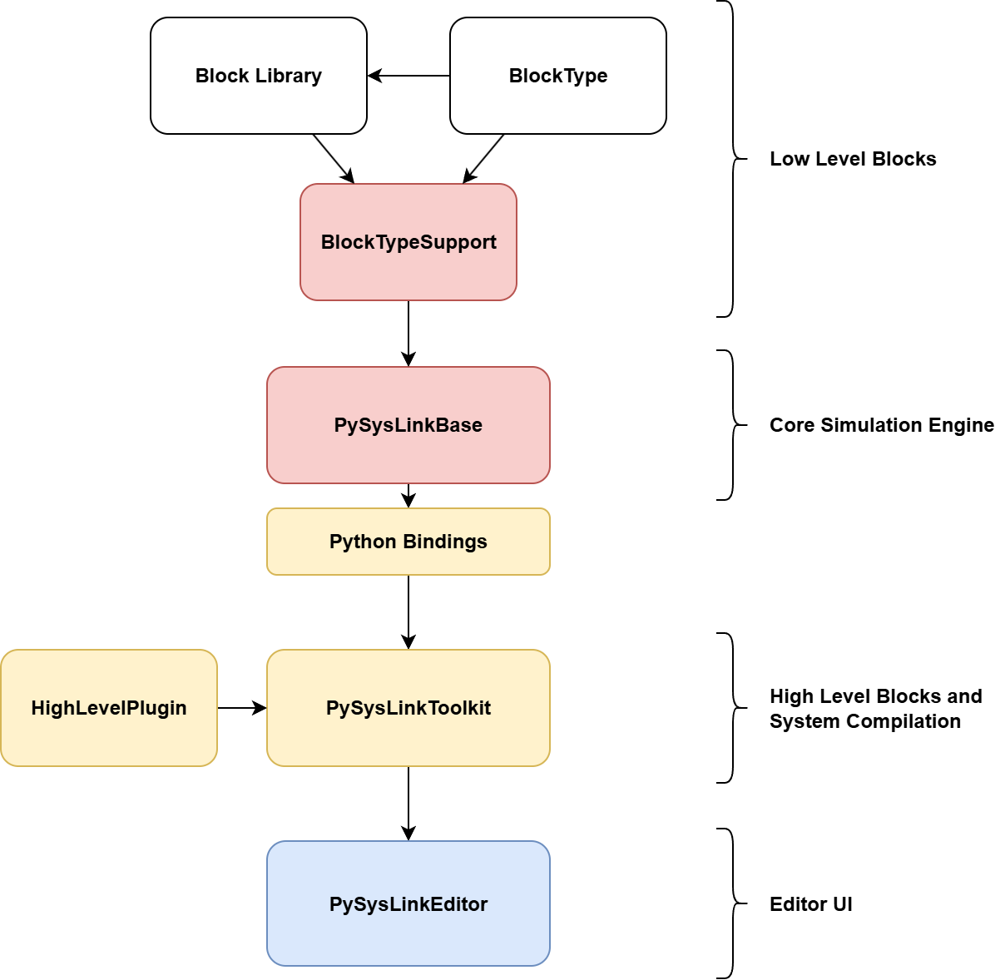

# PySysLink – Open Source Block-Based Simulation Framework

**PySysLink** is a modular, open source simulation framework inspired by tools like Simulink. Designed for scientific computing, control engineering, and dynamic system modeling, PySysLink lets you define and simulate complex systems using a flexible architecture powered by **C++**, **Python**, and **VSCode**.

**Documentation**: [https://pysyslink.readthedocs.io/en/latest/](https://pysyslink.readthedocs.io/en/latest/)

**Github Organization**: [https://github.com/PySysLink](https://github.com/PySysLink)

## What is PySysLink?

PySysLink is an open and extensible alternative to proprietary simulation tools. It allows users to:

- **Define simulation models** using a visual block editor.
- **Run dynamic system simulations**, model physical systems, control loops, and cyber-physical architectures in a unified simulation engine.
- **Create and load plug-ins** for defining new blocks with greate flexibility.
- **Control simulations from Python**, using high-performance bindings to the C++ core.

## Key Features

- **Modular Architecture:** Core simulation logic is decoupled from block implementations.
- **Plug‑In Support:** Easily add new block libraries without modifying the core engine.
- **C++ Core, Python Integration:** Use a high-performance C++ backend with Python interfaces for parameter initialization, execution, and full simulation control
- **Text-Based Model Definitions:** Easily write and share simulation models using human-readable config files.
- **Open and Community‑Driven:** An open source alternative to proprietary simulation tools, built using widely adopted programming standards.

## PySysLink Structure

### Simulation Workflow

Below is the end‑to‑end flow of a typical PySysLink simulation:

1. **Visual Modeling**  
   - You design your system in **PySysLinkEditor** (a VS Code extension) using a drag‑and‑drop block interface.  
   - The editor saves your model as a JSON document with **high‑level blocks**, visual coordinates, and parameter expressions.

2. **Compilation**  
   - When you launch a simulation, the **PySysLinkToolkit** (Python library) transforms the high‑level JSON into a **low‑level YAML** representation.  
   - The YAML model contains only elemental, simulable blocks, without UI metadata or nested subsystems.

3. **Simulation Execution**  
   - **PySysLinkBase** (C++ core engine) loads the YAML file, instantiates each block, and runs the simulation loop.  
   - Outputs are written to JSON or HDF5 files for further analysis.

4. **Result Visualization**  
   - Back in VS Code, **PySysLinkEditor** reads the simulation outputs and renders plots or display blocks inline, giving you immediate feedback on your model’s behavior.

---

### Plugin Architecture

PySysLink’s power comes from its flexible plug‑in model, allowing you to extend both high and low‑level functionality without touching the core code:

